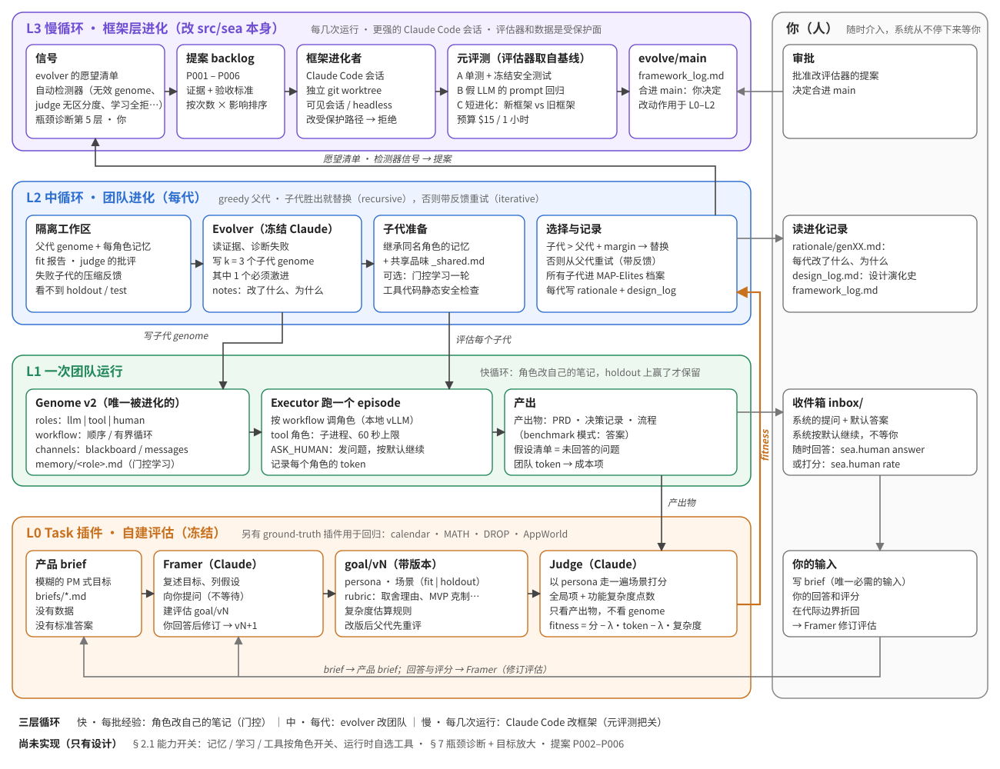

# Self-Evolving Agent Teams

A small workflow in which a frozen **evolver** (Claude, run headless via the `claude` CLI) repeatedly redesigns a
**team of agents**. The team is described by a *genome*: roles (LLM, Python tool, or human), a workflow, a
communication channel and the artifacts it must produce. Each generation the evolver reads the parent genome, its
evaluation and its failures, and writes k child genomes; a child replaces the parent only if it is better.



**v2 (branch `v2-open-ended`, package `src/sea/`)** generalises this from benchmarks to **open-ended product briefs**
with no dataset: the system restates a vague brief, lists assumptions, asks the human (without waiting), builds its own
evaluation (personas, scenarios, rubric, complexity model) and revises it when the human answers. Benchmarks
(calendar / MATH / DROP / AppWorld) are plugins with ground truth, kept for regression. Design:
[`docs/architecture_v2.md`](docs/architecture_v2.md) (Chinese). v1 code (`src/calevo/`) is unchanged and still runs.

```
L2  evolver (Claude, frozen)   reads TaskView files + feedback -> writes k children (last one radical with --radical)
      HumanChannel             ask_human: question + default -> runs/<run>/inbox/, never blocks; folded in between generations
      rationale/<gen>.md       what changed, on which evidence, why accepted/rejected; design_log.md for accepted designs
L1  genome v2                  roles[llm|tool|human] · workflow (sequence / loop) · channels (blackboard / messages)
                               · artifacts · memory/<role>.md (gated learning) · memory/_shared.md (human answers)
L0  Task plugin (frozen)       bench:calendar|math|drop · appworld · brief:<file.md> (Framer + Judge, versioned goal/v<N>/)
```

- **Recursive / iterative**: as in v1; acceptance needs `fitness > parent + margin` (0.02 for briefs, against judge noise).
- **Fitness** is a `FitnessSpec` of weighted terms. Benchmarks: `Σ w·score(split) − λ·tokens/1000`.
  Briefs: `score(fit) − λ_tok·team_tokens/1000 − λ_cx·complexity_points/100`.
- **Isolation**: the evolver workspace only holds what `Task.workspace_files()` returns (fit split only); holdout
  scenarios / splits are used only to gate memory updates; tool code is statically checked for references to eval data.
- **Gated per-agent learning** (`sea.learn`): each LLM role rewrites its notes from experience; the new notes are kept
  only if the team with them beats the old notes on the holdout split.
- **Diversity archive** (`sea.archive`): every child is filed by (LLM roles, token band, mechanism); the radical child
  survives there if it opens a new niche. Parent selection is still greedy.

### v2 quick start

```bash
# product brief mode: Framer = Claude (once per evaluation version), team = local worker, judge = --judge
PYTHONPATH=src python -m sea.evolve --task brief:briefs/day_planner.md --run runs/brief_demo \
    --start genomes/v2/brief_P0 --gens 3 --k 3 --radical --judge claude:sonnet
PYTHONPATH=src python -m sea.human --inbox runs/brief_demo/inbox list            # questions the system asked you
PYTHONPATH=src python -m sea.human --inbox runs/brief_demo/inbox answer Q1 "..."  # answer whenever; next generation folds it in
PYTHONPATH=src python -m sea.human --inbox runs/brief_demo/inbox rate gen01_a1_child_2 3 "too many features"
# benchmark plugin (regression), v1 genomes run unchanged on the v2 executor
PYTHONPATH=src python -m sea.run --task bench:calendar --genome genomes/S0 --split dev_in --limit 10 --out runs/x
PYTHONPATH=src python -m sea.evolve --task bench:calendar --run runs/cal_v2 --start genomes/P0
PYTHONPATH=src python -m pytest -q src/sea src/calevo/verifier_test.py
PYTHONPATH=src python -m sea.meta.backlog list                    # framework proposals
PYTHONPATH=src python -m sea.meta.improve prepare P002           # worktree + task file for a Claude Code improver
```

A brief run writes `goal/v<N>/` (restatement, assumptions, personas, scenarios with fit/holdout split, rubric, cost
model, changelog), `inbox/`, `evals/<genome>/<version>/` (team artifacts, judge rows), `rationale/`, `design_log.md`,
`archive.json`, `history.jsonl`.

**Demo (brief mode, `snapshots/v2_brief_demo/`)**: "a day-planning assistant" brief, worker qwen3-30b-a3b, Claude judge,
3 generations: fitness 0.143 → 0.368 → 0.444 → 0.483. Gen 1 fixed a truncated single-PM team (decision log never emitted);
a human answer then revised the evaluation v1 → v2 and the parent was re-scored; gens 2 and 3 were each won on the retry
with condensed feedback (gen 2 by the radical child); the final team has 2 roles and uses 10.6k tokens. Single run, no repeats.

**Framework-level evolution (`src/sea/meta/`)**: proposals P001-P006 in `runs/meta/backlog/`; P001 (shared-memory dedupe)
was implemented by a separate Claude Code session and merged after tiers A/B passed; tier C failed on noise alone
(see `docs/framework_log.md`), which is now proposal P006. Related work and how it differs: [`docs/related_work.md`](docs/related_work.md).

**Judge choice matters**: on the same PRD, qwen2.5-72b scored 0.97 with the plain prompt ("design is perfect") and a
flat 0.475 on every scenario with the calibrated prompt; Claude sonnet gave 0.31-0.40 with per-scenario,
specific critiques. Use `--judge claude:sonnet` for real runs; the local default only suits dry runs.

## v1 (benchmark genome evolution, `src/calevo/`)

## Benchmarks wired in

| task | data | scorer | splits |
|---|---|---|---|
| calendar | [nvidia/Nemotron-RL-agent-calendar_scheduling](https://huggingface.co/datasets/nvidia/Nemotron-RL-agent-calendar_scheduling) (+ v2) | official NeMo Gym grader (vendored, Apache-2.0) + soft-preference scoring | dev_in, test_in, test_v2, ood_dev/ood_test (generated preference sets), dev_hard/test_hard_v/test_hard_h (Claude-paraphrased, weighted, conflicting) |
| math | MATH Level 5 (4 types, as in AFlow) | last `\boxed{}` + `math-verify` equivalence | math_dev 121 / math_test 484 |
| drop | DROP validation, 1000 sampled (as in AFlow) | token F1, max over annotator alternatives | drop_dev 200 / drop_test 800 |
| appworld | [AppWorld](https://github.com/StonyBrookNLP/appworld) | official unit-test evaluation | train / dev / test_normal (data NOT included — install it yourself, see `appworld/README.md`) |

## Layout

```
src/sea/           v2 core (see above): genome.py executor.py llm.py human.py fitness.py evolve.py learn.py archive.py
  tasks/           base.py benchmark.py appworld.py brief/{task,framer,judge}.py
briefs/            example product briefs;  genomes/v2/brief_P0  starting team for brief mode
src/calevo/
  runner.py        L0: execute a genome on a split, score, count tokens  (python -m calevo.runner)
  evolve.py        L2: resumable evolution loop                          (python -m calevo.evolve)
  tasks.py         per-task scoring + MATH/DROP split builder           (python -m calevo.tasks)
  verifier.py      calendar verifier (wraps official_grader.py) + preference checks
  solver.py        reference backtracking / max-weight scheduler (feasibility checks, S0 baseline)
  report.py        final test-split table + evolution curves             (python -m calevo.report)
  learn.py         per-agent continual learning: each LLM role rewrites its own memory/<role>.md (python -m calevo.learn)
ood/               preference-set builders (build.py: template OOD; build_v2.py: paraphrased hard set) + specs
genomes/           P0 (single prompt) and S0 (fixed-DSL solver) starting genomes
tasks_desc/        task descriptions handed to the evolver for non-calendar tasks
appworld/          AppWorld harness: run_baseline.py, run_genome.py, genomes/P0
data/splits/       prepared splits (see Data licences)
snapshots/v1_model_top/   best genomes (incl. evolved tool code), per-run histories, test reports, write-up
viz/team_evolution.html   per-generation team size / score / tokens visualisation
docs/              REPORT.md, curves, development log of the first overnight run
```

## Quick start

```bash
pip install -r requirements.txt
# 1. serve worker models with any OpenAI-compatible server (we used vLLM), ports as in runner.ENDPOINTS:
#    qwen3-8b :8100, qwen3-30b-a3b :8101, qwen2.5-72b :8102
# 2. baseline
PYTHONPATH=src python -m calevo.runner --genome genomes/P0 --split dev_in --worker qwen3-30b-a3b --out runs/p0_dev
# 3. evolve (needs the `claude` CLI logged in; env vars choose splits / weights / lambda / task description)
CALEVO_SPLITS="dev_in:0.6,ood_dev:0.4" PYTHONPATH=src python -m calevo.evolve --run runs/evo_full --worker qwen3-30b-a3b
CALEVO_SPLITS="math_dev:1.0" CALEVO_SPECS="" CALEVO_TASK_DESC=tasks_desc/math.md CALEVO_LAMBDA=0.01 \
  PYTHONPATH=src python -m calevo.evolve --run runs/evo_math --worker qwen3-8b
# 4. final test-split report
PYTHONPATH=src python -m calevo.report --run-missing
```

Configuration knobs (environment variables read by `evolve.py`): `CALEVO_SPLITS` (fitness splits and
weights), `CALEVO_LAMBDA` (token penalty), `CALEVO_SPECS` (spec files the evolver may read),
`CALEVO_TASK_DESC` (task description file), `CALEVO_SCHEMA_DOC` (genome schema doc, e.g. for AppWorld).
Evolved tool code runs in a subprocess with a 60 s limit; it is written by the evolver, so run this only
on machines where that is acceptable.

## Beyond a genetic algorithm: agents that keep learning

Every LLM role can own a notebook `memory/<role>.md` that is injected into its prompt. `calevo.learn` runs the
*fast loop*: the team solves a batch from an experience split, then each role reflects on its own outputs and
rewrites its notes. With `CALEVO_LEARN="math_train:40"`, `calevo.evolve` (the *slow loop*) lets children inherit
the parent's notes for same-named roles and learn one round before evaluation (Lamarckian). The broader
open-ended plan (goal escalation, diversity archive, innovation pressure, asking humans without waiting) and its
current status are in [`docs/open_ended_design.md`](docs/open_ended_design.md).

## Findings so far (details in `snapshots/v1_model_top/SNAPSHOT.md`, `docs/dev_log/`)

- Calendar v1 saturates: the evolved team (3 roles, 1 LLM, ~900 tokens/sample) scores 1.000 on test_in vs
  0.320 for a single prompt, but unseen preference types (ood_test 0.625) and free-form paraphrases
  (test_hard_h 0.415) remain hard.
- A strong token penalty drives evolution to delete the LLM entirely (0-token regex solver): perfect
  in-distribution, brittle under new phrasing (test_v2 0.41). Lowering λ keeps the LLM and generalises better.
- On harder tasks the team grows instead: MATH Lv5 → 6 roles (3 LLM), DROP → 3 roles (2 LLM).
- Small dev sets overfit: DROP dev 0.797 → 0.919 after evolution, but test only 0.808 → 0.830.
- First per-agent learning result is negative (generic notes lengthen answers); verified memory updates are next.

## Data licences

Splits in `data/splits/` are derived from: Nemotron-RL calendar scheduling v1 and v2 (CC-BY-4.0, NVIDIA),
MATH (MIT, Hendrycks et al.), DROP (CC-BY-SA-4.0, AllenAI). Generated preference sentences were written by
Claude. `src/calevo/official_grader.py` is copied from NVIDIA NeMo Gym (Apache-2.0). AppWorld data is not
redistributed here.
